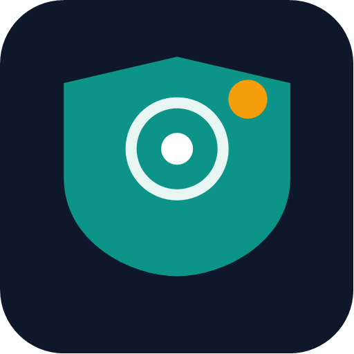

# DNS Proxy

**A Windows DNS proxy with selectable public resolvers and built-in domain blocking.**

Point your machine at `127.0.0.1`, pick Google / Cloudflare / OpenDNS (or your own upstreams), and block YouTube, Roblox, social media, or any custom list — while everything else resolves normally through your chosen upstream.

<p align="center">
  
</p>

## Features

- **Local DNS service** — listens on `127.0.0.1:53` as a proper Windows service
- **Upstream presets** — Google (`8.8.8.8` / `8.8.4.4`), Cloudflare (`1.1.1.1` / `1.0.0.1`), OpenDNS (`208.67.222.222` / `208.67.220.220`)
- **Custom upstreams** — add any IPv4/IPv6 resolvers you want
- **Category blocking** — YouTube, Roblox, social media toggles plus a free-form custom list
- **Block modes** — answer with **NXDOMAIN** or a **sinkhole** IP
- **Desktop control panel** — pick upstreams, manage blocks, install/start/stop the service
- **Persisted config** — JSON on disk under `%LOCALAPPDATA%\DNS Proxy\config.json`

## Workspace layout

| Crate | Binary | Role |
|---|---|---|
| `dns-proxy-core` | — | Shared config, presets, block engine |
| `dns-proxy-service` | `dns-proxy-service.exe` | UDP DNS proxy + Windows service |
| `dns-proxy-ui` | `dns-proxy-ui.exe` | egui control panel |

## Prerequisites

- Windows 10 / 11
- [Rust](https://rustup.rs/) (stable, edition 2021+)
- **Administrator** privileges to bind UDP port `53` and to install/control the Windows service

> Binding to port 53 and registering a Windows service both require elevation (UAC). Running the UI or service without admin rights will fail those operations.

## Build

```powershell
cd "C:\Users\Warren\Documents\Projects\DNS Proxy"
cargo build --release
```

Binaries land in `target\release\`:

- `dns-proxy-service.exe`
- `dns-proxy-ui.exe`

Icon assets live in [`assets/`](assets/) (`dns-proxy.ico`, `dns-proxy-icon.png`) and are embedded into the Windows binaries at build time.

## Quick start (console)

Useful for smoke-testing without installing a service:

```powershell
# Elevated PowerShell recommended
.\target\release\dns-proxy-service.exe init-config
.\target\release\dns-proxy-service.exe console
```

Then set your adapter DNS to `127.0.0.1` and try:

```powershell
nslookup example.com 127.0.0.1
nslookup youtube.com 127.0.0.1
```

## Install as a Windows service

From an **elevated** PowerShell:

```powershell
cd "C:\Users\Warren\Documents\Projects\DNS Proxy\target\release"

# Register the service (LocalSystem, auto-start)
.\dns-proxy-service.exe install

# Start / stop / status
.\dns-proxy-service.exe start
.\dns-proxy-service.exe status
.\dns-proxy-service.exe stop

# Remove
.\dns-proxy-service.exe uninstall
```

Equivalent SCM commands:

```powershell
sc.exe start DnsProxy
sc.exe stop DnsProxy
sc.exe delete DnsProxy
```

Or use the control panel buttons in `dns-proxy-ui.exe` (also needs elevation for install/uninstall).

### Helper scripts

```powershell
.\scripts\install-service.ps1   # build release (if needed) + install + start
.\scripts\uninstall-service.ps1
```

## Control panel

```powershell
.\target\release\dns-proxy-ui.exe
```

From the UI you can:

1. Choose a preset or custom upstream
2. Toggle YouTube / Roblox / social media blocks and edit the custom list
3. Switch between NXDOMAIN and sinkhole responses
4. Save config, then install / start / stop the Windows service

**Note:** the running service reads config at start. After saving changes, restart the service for them to take effect.

## Configuration

Default path: `%LOCALAPPDATA%\DNS Proxy\config.json`

```json
{
  "listen": "127.0.0.1:53",
  "upstream": {
    "type": "preset",
    "preset": "cloudflare"
  },
  "block": {
    "youtube": true,
    "roblox": true,
    "social": true,
    "custom": ["example-ads.test"],
    "mode": "nxdomain",
    "sinkhole_ip": "0.0.0.0"
  },
  "verbose_logging": false
}
```

Custom upstream example:

```json
"upstream": {
  "type": "custom",
  "servers": ["9.9.9.9", "149.112.112.112"]
}
```

## Point Windows at the proxy

1. Install & start the service (or run `console`)
2. Open **Settings → Network & Internet → your adapter → DNS server assignment → Manual**
3. Set Preferred DNS to `127.0.0.1` (leave alternate empty or set a fallback you accept)
4. Flush the cache: `ipconfig /flushdns`

To undo, set DNS back to Automatic (DHCP) or your previous resolvers, then stop/uninstall the service.

## Security & admin notes

| Action | Elevation needed? |
|---|---|
| Build / run UI | No |
| Bind `127.0.0.1:53` | Yes (or grant capability) |
| Install / uninstall service | Yes |
| Start / stop service | Yes (or appropriate rights) |
| Edit `config.json` | No (per-user LOCALAPPDATA) |

This project is a **local** filtering proxy. It does not encrypt DNS on the wire to upstreams (plain UDP/53). For DNS-over-HTTPS/TLS, terminate that on a separate forwarder and point DNS Proxy’s custom upstream at it.

## License

MIT — see [LICENSE](LICENSE).
